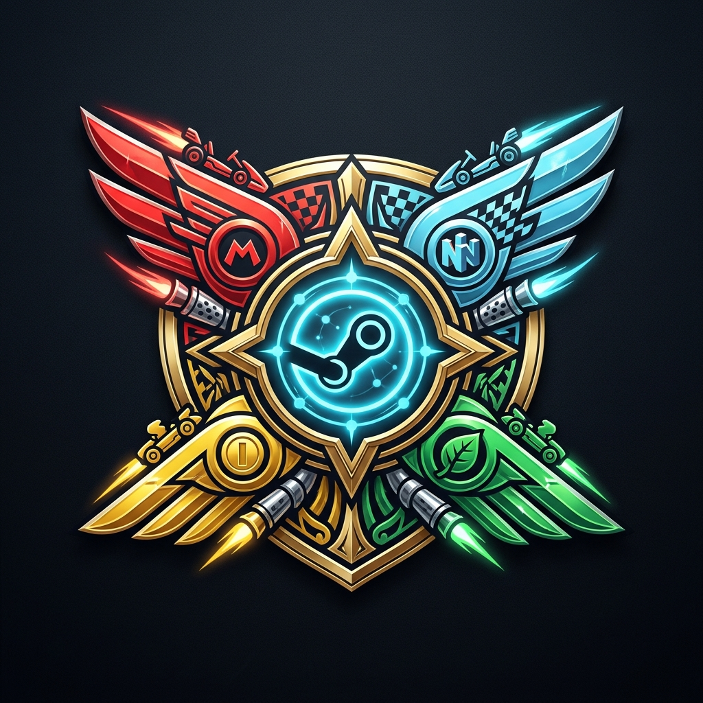

<p align="center"></p>

<h1 align="center">MKW Together v0.8</h1>

<p align="center">
  <a href="README.md">Français</a> · <b>English</b>
</p>

<p align="center">
  <b>Mario Kart World on PC with Steam Remote Play Together, for split-screen with friends who are not in the room.</b>
</p>

<p align="center">
  <a href="https://github.com/sinedgiveaways/mkw-remote-together/releases/download/v0.8/mkw-together-v0.8-windows-x64.zip"><b>⬇ Download: MKW Together v0.8 (Windows x64, zip)</b></a>
</p>

---

## Build source

This build comes from **https://github.com/adriadam10/mkw-recomp**, a static recompilation of Mario Kart World for
Linux and Windows. It is based on its **0.1.15** release, plus Steam Remote Play Together support and the MKW Together
look (the [`mkw-together`](https://github.com/sinedgiveaways/mkw-recomp/tree/mkw-together) branch of the
sinedgiveaways/mkw-recomp fork). All credit for the recompilation goes to its author and contributors.

> **Nothing of the game is included.** You need your own copy of Mario Kart World, dumped from your own console
> (`exefs/` and `romfs/`, or one `.nup` / `.nx` file). Version 1.0.0 or 1.8.0.

## What's new in 0.8

- The program is now called **`mkw-together.exe`**, in a `mkw-together/` folder.
- **Automatic updates** from this repository: the start screen offers new MKW Together releases and installs them.
- No more black (console) windows at start.

> **Had 0.7?** Install 0.8 by hand once: 0.7 looks for updates at adriadam10/mkw-recomp and will not offer it. Unpack
> 0.8 into a **new folder** and press **Set up** again, then change the path in the Steam launch options
> (`mkw-together.exe`, see below). After that, later versions install themselves.

## What is in the zip

The zip (`mkw-together-v0.8-windows-x64.zip`, 218 MB, [Release v0.8](https://github.com/sinedgiveaways/mkw-remote-together/releases/tag/v0.8))
holds a `mkw-together/` folder with the files below. The four DLLs are also in this repository's [`dll/`](dll/)
folder: if one is missing next to `mkw-together.exe`, copy it from there.

| File | What it does |
|---|---|
| `mkw-together.exe` | the launcher and the game |
| `steam_api64.dll` | Steam's library (Steamworks SDK 1.65), **required for Remote Play Together** |
| `SDL3.dll`, `libopus-0.dll`, `libusb-1.0.dll` | input, audio and USB libraries |
| `setup/` | the tools that prepare the game on your machine |

SHA-256 of `steam_api64.dll`: `e6d9bafb9a41e42fba7b21553db49f8719027af3f0deb23ff86cfc44d60e776d`
(Valve's official file; check it with `certutil -hashfile steam_api64.dll SHA256`).

## How it works

Remote Play Together is the Steam feature that streams the game's window and sound to your friends. Their
controllers (or keyboards) become players 2, 3, 4… of the split-screen game, up to 8 players depending on the mode.
They only need Steam, the Steam Link app, or a browser with a guest link: **not the game**.

The game presents itself to Steam as a game of your library that supports Remote Play Together (by default
RetroArch, App ID `1118310`, free). Your friends therefore see that game's name in Steam.

### Requirements

- Windows 10 or 11 x64, an x86-64 CPU with AVX2, a Vulkan 1.3 GPU, about 30 GB free, 16 GB of RAM recommended.
- Steam installed, running and signed in on the PC that runs the game (the host).
- A game of your library with Remote Play Together installed in Steam (for example Streets of Rage 4, or RetroArch,
  which is free).
- Your dump of Mario Kart World.

### Installation

1. Download the zip from this [download link](https://github.com/sinedgiveaways/mkw-remote-together/releases/download/v0.8/mkw-together-v0.8-windows-x64.zip)
   and unpack it into a folder.
2. Run `mkw-together.exe`, open **Game files**, choose your dump and press **Set up**. The first setup takes a while
   (the game is compiled on your machine). Then press **Play**.

### Turning on Remote Play Together

`steam_api64.dll` is already next to `mkw-together.exe`: there is nothing to download.

1. **The App ID: the Steam game of your choice.** mkw-together presents itself to Steam as a game of your library.
   You can pick **any game you own**, as long as its Steam page lists "Remote Play Together". The App ID is the number
   in its store address: `store.steampowered.com/app/<number>/`. Your friends will see that game's name in Steam.

   Example with **Streets of Rage 4** (App ID `985890`), which works well with both the host's and the guests'
   controllers. In `mkw.ini` (next to `mkw-together.exe`):

   ```ini
   [steam]
   steam_appid = 985890
   ```

   RetroArch (`1118310`, free) works too. The menu has the same setting: `F1` > General > Steam Remote Play Together >
   Steam App ID (it takes effect at the next start). **Enter a Steam App ID** lets you type another number there.

2. **Start from Steam** (needed for your friends' controllers to reach the game):
   - install the game picked in step 1 in Steam (here Streets of Rage 4);
   - right-click that game > Properties > General > Launch options, then enter the path of `mkw-together.exe` in quotes
     followed by `%command%`, for example:

     ```
     "C:\Users\you\Downloads\mkw-together\mkw-together.exe" %command%
     ```

   - press Play on that game in Steam. To get the real game back, empty the launch options.

   Started from its own folder, the game accepts invitations, but Steam does not hand it the guests' controllers. A
   "non-Steam game" shortcut does not work either.

3. **Invite.** In the game, menu `F1` > General > **Steam Remote Play Together**:
   - **Invite friends** opens Steam's invite list;
   - **Copy guest link** copies a link to send to anyone (browser or Steam Link, no Steam friendship needed).

   Picking local multiplayer (2 to 4 players) with fewer controllers than players offers to open the invite list.
   Once your guests have joined and pressed a button on their controller, pick the mode again.

In `logs/mkw.log`, the line `steam: running as App ID ...; Remote Play Together ready` confirms everything is ready.

### Good to know

- Guests cannot open the menu (`Esc`, `F1`, `F10`, `F11` stay with the host).
- A guest without a controller gets a player at the first key they press (WASD, Space, Shift…).
- The Steam Input settings of the game used as the App ID change the result. RetroArch (`1118310`) and Streets of
  Rage 4 (`985890`) worked for both the host's and the guests' controllers.
- The game reads the App ID at start: changing it needs a restart.
- On Linux under Wayland, if guests see "Steam not launched with -pipewire", start Steam with `steam -pipewire`.
  (This build only ships the Windows zip.)
- **Updates:** the start screen offers new releases published in this repository
  (`sinedgiveaways/mkw-remote-together`) and installs them. **Settings > Menu > Check for updates** turns the check
  off.

### Test status

Remote Play Together support was tested against Steam's 1.65 library and a mock of Steam (start-up, guests joining
and leaving, a guest's controller as player 2, a guest's keyboard as player 3, the guest link, failures). The
project's documentation says a real session with friends over Steam had not been run yet when it was written.

### Checking the build

The zip is the one GitHub Actions built for the `v0.8` tag of the `mkw-together` branch of the
`sinedgiveaways/mkw-recomp` fork, published unchanged. SHA-256 of the zip:
`c444f75dece3bd9264137c15e12d3e875106aeca9f231b92e72be27c9e391d78`. Detailed documentation:
`docs/guides/remote-play.md` in the fork's `mkw-together` branch.

0.7 (`MKW-remote-together-v0.7-windows-x64.zip`, with `mkw.exe`) is still available in its
[Release](https://github.com/sinedgiveaways/mkw-remote-together/releases/tag/v0.7).
