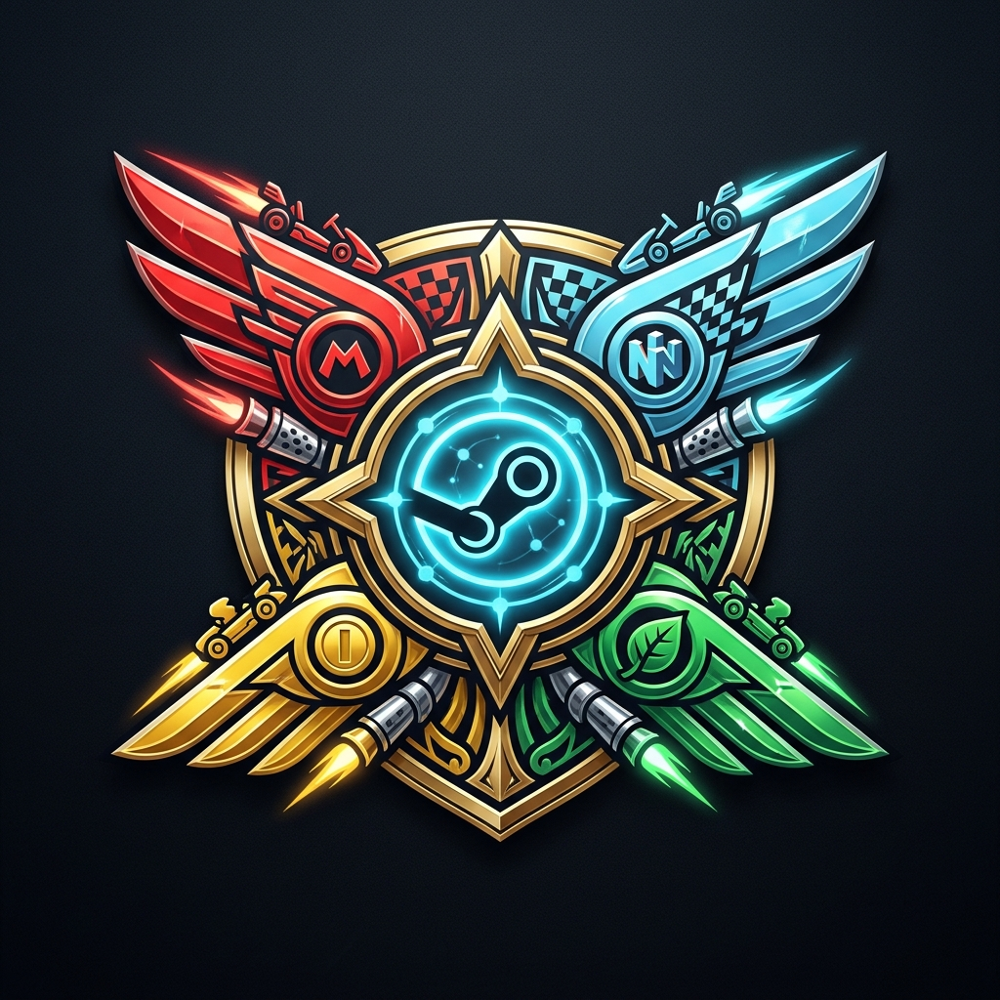

<p align="center"></p>

<h1 align="center">MKW Together v0.8</h1>

<p align="center">
  <b>Français</b> · <a href="README.en.md">English</a>
</p>

<p align="center">
  <b>Mario Kart World sur PC avec Steam Remote Play Together, pour jouer en écran partagé avec des amis à distance.</b>
</p>

<p align="center">
  <a href="https://github.com/sinedgiveaways/mkw-remote-together/releases/download/v0.8/mkw-together-v0.8-windows-x64.zip"><b>⬇ Télécharger : MKW Together v0.8 (Windows x64, zip)</b></a>
</p>

---

## Source du build

Ce build vient de **https://github.com/adriadam10/mkw-recomp** (recompilation statique de Mario Kart World pour
Linux et Windows). Il est basé sur sa version **0.1.15**, avec en plus le support de Steam Remote Play Together
et l'habillage MKW Together (branche [`mkw-together`](https://github.com/sinedgiveaways/mkw-recomp/tree/mkw-together)
du fork sinedgiveaways/mkw-recomp).
Tout le mérite de la recompilation revient à son auteur et à ses contributeurs.

> **Rien du jeu n'est inclus.** Il faut votre propre copie de Mario Kart World, extraite de votre propre console
> (`exefs/` et `romfs/`, ou un fichier `.nup` / `.nx`). Version 1.0.0 ou 1.8.0.

## Nouveautés de la v0.8

- Le programme s'appelle maintenant **`mkw-together.exe`**, dans un dossier `mkw-together/`.
- **Mises à jour automatiques** depuis ce dépôt : l'écran d'accueil propose les nouvelles versions de MKW Together et
  les installe.
- Nouveau fond d'écran et nouveau logo (aussi l'icône du programme).
- Plus de liens GitHub et Discord sur l'écran d'accueil.
- Plus de fenêtres noires (consoles) au démarrage.

> **Vous aviez la v0.7 ?** Installez la v0.8 à la main une fois : la v0.7 cherche ses mises à jour chez
> adriadam10/mkw-recomp et ne la proposera pas. Dézippez la v0.8 dans un **nouveau dossier** et refaites **Set up**,
> puis changez le chemin dans les options de lancement Steam (`mkw-together.exe`, voir plus bas). Ensuite, les
> versions suivantes s'installeront toutes seules.

## Contenu du zip

Le zip (`mkw-together-v0.8-windows-x64.zip`, 218 Mo, [Release v0.8](https://github.com/sinedgiveaways/mkw-remote-together/releases/tag/v0.8)) contient le dossier `mkw-together/` avec les éléments
ci-dessous. Les quatre DLL sont aussi dans le dossier [`dll/`](dll/) de ce dépôt : si l'une manque à côté de
`mkw-together.exe`, copiez-la depuis ce dossier.

| Fichier | Rôle |
|---|---|
| `mkw-together.exe` | le lanceur et le jeu |
| `steam_api64.dll` | la bibliothèque de Steam (Steamworks SDK 1.65), **indispensable à Remote Play Together** |
| `SDL3.dll`, `libopus-0.dll`, `libusb-1.0.dll` | bibliothèques d'entrée, d'audio et USB |
| `setup/` | les outils qui préparent le jeu sur votre machine |

SHA-256 de `steam_api64.dll` : `e6d9bafb9a41e42fba7b21553db49f8719027af3f0deb23ff86cfc44d60e776d`
(c'est le fichier officiel de Valve, vérifiable avec `certutil -hashfile steam_api64.dll SHA256`).

## Comment ça marche

Remote Play Together est la fonction de Steam qui diffuse la fenêtre et le son du jeu à vos amis. Leurs manettes
(ou claviers) deviennent les joueurs 2, 3, 4… du jeu en écran partagé, jusqu'à 8 joueurs selon le mode. Ils n'ont
besoin que de Steam, de l'application Steam Link, ou d'un navigateur avec un lien invité : **pas du jeu**.

Le jeu se déclare à Steam sous l'identité d'un jeu de votre bibliothèque qui supporte Remote Play Together
(par défaut RetroArch, App ID `1118310`, gratuit). Vos amis voient donc le nom de ce jeu dans Steam.

### Ce qu'il faut

- Windows 10 ou 11 x64, processeur x86-64 avec AVX2, GPU Vulkan 1.3, environ 30 Go libres, 16 Go de RAM conseillés.
- Steam installé, lancé et connecté sur le PC qui fait tourner le jeu (l'hôte).
- Le jeu RetroArch (ou un autre jeu de votre bibliothèque avec Remote Play Together) installé dans Steam.
- Votre dump de Mario Kart World.

### Installation

1. Téléchargez le zip depuis ce [lien de téléchargement](https://github.com/sinedgiveaways/mkw-remote-together/releases/download/v0.8/mkw-together-v0.8-windows-x64.zip) et dézippez-le dans un dossier.
2. Lancez `mkw-together.exe`, ouvrez **Fichiers du jeu**, choisissez votre dump puis appuyez sur **Set up**.
   La première préparation est longue (le jeu est compilé sur votre machine). Ensuite, **Jouer**.

### Activer Remote Play Together

`steam_api64.dll` est déjà à côté de `mkw-together.exe` : il n'y a rien à télécharger.

1. **L'App ID.** Dans `mkw.ini` (à côté de `mkw-together.exe`) :

   ```ini
   [steam]
   steam_appid = 1118310
   ```

   Le même réglage existe dans le menu : `F1` > General > Steam Remote Play Together > Steam App ID
   (pris en compte au démarrage suivant).

2. **Lancer depuis Steam** (nécessaire pour que les manettes de vos amis arrivent dans le jeu) :
   - installez RetroArch dans Steam ;
   - clic droit > Propriétés > Général > Options de lancement, puis saisissez le chemin de `mkw-together.exe` entre
     guillemets suivi de `%command%`, par exemple :

     ```
     "C:\Users\vous\Downloads\mkw-together\mkw-together.exe" %command%
     ```

   - appuyez sur Jouer dans Steam. Pour revenir au vrai RetroArch, videz les options de lancement.

   Lancé directement depuis son dossier, le jeu accepte les invitations, mais Steam ne lui donne pas les manettes
   des invités. Un raccourci « jeu non-Steam » ne fonctionne pas non plus.

3. **Inviter.** Dans le jeu, menu `F1` > General > **Steam Remote Play Together** :
   - **Invite friends** ouvre la liste d'invitation de Steam ;
   - **Copy guest link** copie un lien à envoyer à n'importe qui (navigateur ou Steam Link, sans compte ami).

   En choisissant le multijoueur local (2 à 4 joueurs) avec moins de manettes que de joueurs, le jeu propose
   d'ouvrir la liste d'invitation. Quand les invités ont rejoint et appuyé sur un bouton de leur manette,
   choisissez de nouveau le mode.

Dans `logs/mkw.log`, la ligne `steam: running as App ID ...; Remote Play Together ready` confirme que tout est prêt.

### Bon à savoir

- Les invités ne peuvent pas ouvrir le menu (`Esc`, `F1`, `F10`, `F11` restent à l'hôte).
- Un invité sans manette obtient un joueur à la première touche pressée (WASD, Espace, Maj…).
- Les réglages Steam Input du jeu choisi comme App ID changent le résultat. RetroArch (`1118310`) et
  Streets of Rage 4 (`985890`) ont fonctionné pour les manettes de l'hôte et des invités.
- Le jeu lit l'App ID au démarrage : un changement demande un redémarrage.
- Sous Linux Wayland, si les invités voient « Steam not launched with -pipewire », lancez Steam avec
  `steam -pipewire`. (Ce build ne fournit que le zip Windows.)
- **Mises à jour :** l'écran d'accueil propose les nouvelles versions publiées dans ce dépôt
  (`sinedgiveaways/mkw-remote-together`) et les installe. **Paramètres > Menu > Check for updates** désactive la
  vérification.

### État des tests

Le support de Remote Play Together a été testé contre la bibliothèque Steam 1.65 et une simulation de Steam
(démarrage, invités qui arrivent et partent, manette d'invité en joueur 2, clavier d'invité en joueur 3, lien
invité, erreurs). La documentation du projet indique qu'une vraie session avec des amis via Steam n'avait pas
encore été faite au moment de son écriture.

### Vérifier le build

Le zip est celui que GitHub Actions a construit pour le tag `v0.8` de la branche `mkw-together` du fork
`sinedgiveaways/mkw-recomp`, republié tel quel. SHA-256 du zip :
`c444f75dece3bd9264137c15e12d3e875106aeca9f231b92e72be27c9e391d78`. Documentation détaillée :
`docs/guides/remote-play.md` dans la branche `mkw-together` du fork.

La v0.7 (`MKW-remote-together-v0.7-windows-x64.zip`, avec `mkw.exe`) reste disponible dans sa
[Release](https://github.com/sinedgiveaways/mkw-remote-together/releases/tag/v0.7).

---

*English version: [README.en.md](README.en.md).*
